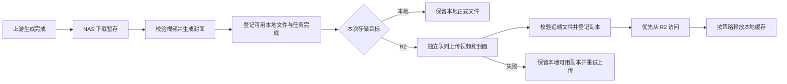

# 本地 / Cloudflare R2 存储与素材管理库设计

日期：2026-10-19。状态：设计稿，未实施、未连接 R2、未操作 NAS 文件。
本文为本功能的实施依据。基于当前工作区代码；上线前再核对 NAS 版本、磁盘容量和实际数据量。

## 1. 目标与默认决策

- 系统设置可选择新文件默认保存到本地或 Cloudflare R2；旧文件按自身记录的存储位置访问，支持两种存储并存。
- 推荐日常采用 R2 主存储，NAS 承担下载、媒体检测、封面生成和短期缓存。不做长期强制双份保存。
- 管理后台新增“素材管理”，支持预览、检索、容量统计、批量迁移，以及按时间范围清理文件。
- 清理文件与删除任务分离：保留任务、批次、提示词、历史成功状态和额度流水；文件已清理时明确提示，不显示为生成失败。
- 首期接入生成视频、封面、系统持有的上传参考素材。外部图片/视频 URL 只作为外链记录，不自动搬运、不删除外部网站文件。
- 全站共用存储配置；不增加用户自行配置存储的入口。存储配置和不可逆文件清理由主管理员操作，普通用户保留现有作品访问范围。
- 自动按年龄清理默认关闭；首期先交付可预览范围的手动清理。数据库、日志和密钥不属于素材库清理范围。

## 2. 当前实现的约束

| 代码位置 | 已确认的行为 | 改造要求 |
| --- | --- | --- |
| `app/core/config.py` | 上传、视频、临时目录默认 `/data/uploads`、`/data/outputs`、`/data/temp` | 保留本地能力和临时工作区 |
| `app/models/tables.py:JobFile` | 用 `file_path` 保存路径；外链类型也占用此字段 | 不能直接将所有路径替换成 R2 URL |
| `app/services/jobs.py` | 文件存在性用 `Path.exists`；下载后检测媒体并生成封面 | 引入统一资源与存储访问接口 |
| `app/api/files/routes.py` | 鉴权后从本地播放、Range 读取、下载和生成封面 | 云端读取必须经过相同权限判断 |
| `app/api/user/routes.py`、`app/services/batch_archives.py` | 批次可下载数量、ZIP 打包依赖本地文件存在 | 改为判断可用资源；打包支持云端源文件 |
| `app/services/worker_downloader.py`、`worker_recovery.py` | 下载到本地后任务完成；恢复逻辑也检查本地路径 | 存储传输与生成任务状态独立，并适配恢复逻辑 |
| `app/services/job_regeneration.py` | 重试复制参考文件路径，多个任务可能使用同一文件 | 删除前按物理资源判断引用关系 |
| `app/api/admin/routes.py:_delete_job` | 删除文件及任务、事件等记录 | 素材清理不能复用此函数 |
| `app/services/media.py` | 封面命名为 `*_poster.jpg` | 显式关联视频和封面，避免按 `.jpg` 后缀猜测 |
| `app/services/temp_cleanup.py` | 仅处理特定临时 ZIP 文件 | 与正式素材清理保持独立 |

## 3. 管理界面

### 系统设置 → 存储设置

| 设置 | 设计 |
| --- | --- |
| 默认存储 | 本地 / Cloudflare R2；影响保存后新建立的存储任务，执行中的任务固定原目标 |
| R2 连接 | 配置名称、S3 Endpoint、Bucket、Access Key ID、Secret Access Key、项目对象前缀；region 默认 `auto` |
| 连接测试 | 显示读、写、删除测试结果；仅在专用探针前缀内操作测试对象，不扫描或修改业务文件 |
| 上传并发 | 与上游下载并发分别设置；建议初始为 3，现有下载并发保持原配置 |
| 重试 | 单文件超时和可重试上传失败间隔；建议 120 秒，可在 Web 修改；鉴权/配置错误暂停重试并提示修复 |
| 本地缓存 | 上传校验成功后默认保留 24 小时；可选立即回收或长期保留本地副本 |
| 暂存容量 | 设置缓存上限和最低剩余空间；待上传的唯一副本不参与缓存淘汰 |
| 传输网络 | R2 上传默认直连，可选择复用已有下载代理；不自动改变生成请求代理 |

密钥复用项目现有加密能力，只返回掩码，空值保存表示保持原密钥。Endpoint、Bucket 或前缀变化创建新的存储配置身份；旧对象仍引用旧配置。正在被资源使用的配置不能直接移除；凭证轮换单独处理，不改变对象归属。

### 管理后台 → 素材管理

顶部汇总：本地正式文件容量、R2 已登记容量、本地缓存、待上传数量、传输失败数量。标注统计时间；R2 数字为本项目登记用量，不冒充整个账号账单或桶容量。

筛选：时间范围、素材类型、所属用户、APP 名称、地区、批次、模型、存储位置、可用/待上传/上传失败/已清理状态、保护状态。

列表：缩略图、素材名、任务/批次、创建时间、用户、规格、大小、存储位置、状态、操作。可切换网格预览。封面通常折叠到视频条目，不重复显示成两条作品。

操作分开命名：

- “下载”：现有文件或批次下载。
- “迁移至 R2 / 迁回本地”：复制、校验、切换读取位置，可选之后清理源副本。
- “释放本地副本”：仅删除已有有效远端副本的本地文件，作品仍可访问。
- “清理素材文件”：删除该资源的所有受管副本，作品变为已清理。
- “保护 / 取消保护”：禁止范围清理；独立于普通用户收藏，避免将收藏误作管理员保护规则。

批量选择提供“本页”和“当前筛选全部”两个明确范围；显示实际资源数和字节数。一次文件清理不把共享物理资源按多条任务重复计数。

## 4. 新任务的存储流程

- 生成状态与存储状态分开。视频已经安全保存并校验后，可继续沿用“任务完成”；同时显示“待上传云端 / 正在上传 / 云端已就绪 / 上传失败”。上传故障不触发重新生成、扣费或退款。
- 上游轮询、上游下载、R2 上传、迁移、打包、删除采用隔离的工作槽与有限并发。采用持久操作记录和租约，进程重启可恢复，不能把上传放进轮询线程或长数据库事务。
- 网络 I/O 期间不持有任务行锁；提交前再次检查资源版本、操作状态和删除标记。对象键含稳定资源 ID 与版本/随机后缀，重试使用同一操作键，不覆盖他人的对象。
- R2 临时不可用时从有效本地副本播放。仅有 R2 副本且 R2 故障时提示暂不可用，不把它当作丢失文件或自动重新生成。
- 大文件使用分段上传；超时、重启及取消后的未完成上传可中止清理。分段 ETag 不作为文件 MD5。记录本地 SHA-256，验证大小和服务支持的传输校验；迁移删除唯一源副本前执行远端读回 SHA-256 校验。
- 空间不足时先清理已确认安全的缓存，暂停新增下载和迁移写入并显著报警；保留轮询和既有未上传文件，不会靠无限堆积掩盖故障。新生成提交也需根据容量阈值提示/限流，避免持续制造无法接收的结果。
- R2 解决长期存储容量，不等于消除“上游下载到 NAS”的网络瓶颈；仍需要本地临时空间。

## 5. 数据与存储接口

建议采用最小的“逻辑素材 + 存储副本”结构，以覆盖本地/R2并存、迁移、共享引用和范围删除：

- `StorageProfile`：类型、名称、连接信息、加密凭证、启停、配置身份。
- `MediaAsset`：类型、归属、原始文件名、大小、SHA-256、宽高时长、原始素材创建时间、状态、保护、清理时间；封面关联父视频。
- `AssetLocation`：资源 ID、配置 ID、本地路径或对象键、副本状态、校验时间、缓存到期时间；同一资源可同时有本地和 R2 副本。
- `StorageOperation` 与明细：上传/迁移/清理/打包的持久进度、重试时间、租约、操作人、冻结候选集合、错误和完成结果。
- `JobFile` 增加 `asset_id`，预设素材增加资源引用。旧 `file_path` 暂时保留用于兼容回填；外部 URL 类型继续作为外链。

对同一规范化本地路径的历史引用先合并成同一受管资源，再逐步回填；不假设不同任务一定拥有独立文件。首期不做全库按内容哈希去重。

存储接口至少提供 `stat`、`open_reader/range`、`put`、`delete`、`signed_read_url`、`materialize_local`。列表直接查询数据库可用性，避免列表页逐条远端 HEAD。定期后台核对物理副本，发现缺失时更新状态并报警。

R2 示例对象键：`lumora/prod/videos/YYYY/MM/DD/<asset_id>/<version>.mp4`；封面、参考素材和临时包使用独立前缀。日期只是组织方式，删除范围以数据库时间为准，不能通过对象前缀推断业务时间。

## 6. 播放、下载和参考素材

- 默认私有 Bucket。继续使用现有 `/app/files/{id}/...` 权限入口；鉴权后发短期签名 URL 或跳转到 R2。权限范围沿用本人、管理角色、允许广场展示等现有逻辑，不改成整个桶公开。
- 签名链接按需生成，不写入数据库。建议有效期 15 分钟；播放过期时重新鉴权取链接并恢复播放位置。支持 Range/拖动、正确 Content-Type 与中文下载名；浏览器验证 CORS、下载响应头与跨域跳转。
- R2 签名 URL 用 S3 API 域名。自定义域名不直接拼接同一签名；如以后需要私有域名/CDN访问，另加鉴权 Worker 网关。
- R2 视频封面预先上传。访问封面不触发整段视频回下载生成；旧缺失封面走后台补建。
- 参考图片在上传时登记尺寸；模型比例校验继续工作。上游要求文件上传时按需缓存到本地；要求 URL 时，提交时生成限该资源的有效链接，覆盖上游最大取图窗口。持久记录资源 ID，而非会过期的 URL；重试重新签发。外部 URL 维持现有行为。
- 云端迁移后，任务失败重试、素材预设、图片尺寸检测都不得依赖永久本地路径。

### 批次 ZIP

保持现有“勾选多个批次，分别下载各批次 ZIP”的使用方式和命名，不改成 ZIP 套 ZIP。

R2 不负责动态把任意对象打成 ZIP。采用后台打包：冻结已授权的可用文件清单，逐个读取本地或 R2 对象，以有界缓冲写入临时 ZIP，不同时落盘全部原视频。打包槽和磁盘空间独立限制，完成后提供下载；R2 模式下可上传到专用临时前缀供直连下载，24 小时清理。

下载前端显示“准备中/可下载/失败”，再按批次顺序触发。打包中资源取得有期限的读取租约，清理任务延后处理。任何成员读取失败均不发布一个冒充完整的 ZIP；记录具体失败项并允许重试。

## 7. 按时间范围清理

时间默认按素材所属任务创建时间筛选生成视频（与用户查任务习惯一致），可切换为视频生成完成时间；参考素材按首次入库时间。页面明确显示当前时间口径。迁移不会刷新原始素材时间，不能把迁移时间当成生成时间。

界面日期按北京时间；“10月1日–10月10日”转换为北京时间 10月1日 00:00 到 10月11日 00:00 的半开区间，再转 UTC 查询，确保包含所选结束日。

操作流程：

1. 选时间范围和条件，默认只勾选生成视频及关联封面。参考素材单独勾选，默认排除预设素材和正在使用的引用。
2. 预览将清理多少视频、多少关联封面、各存储释放多少容量、涉及多少批次；列出受保护、被使用和无法清理的条目。
3. 冻结候选资源 ID 与版本，展示一次具体确认。新进入筛选条件的数据不混入已确认任务。
4. 后台按资源执行；执行前再次检查保护、活动引用和租约。移除访问资格后逐个删除受管副本；失败记为“清理失败”，保留操作记录可重试，不假报已释放空间。
5. 部分副本已经删除的情况单独记录，剩余副本继续重试。重复执行、文件已经不存在均可幂等处理。取消仅停止尚未执行的条目，不能恢复已物理删除的文件。
6. 页面显示完成、跳过、失败数量及原因、实际释放容量；审计记录操作人、时间和范围。

清理后任务保持原生成结果，单独显示“视频文件已清理”。批次下载数只统计仍有有效副本的资源；“我的作品”、广场和详情不再尝试播放不存在的文件。普通“下载失败重试”和恢复扫描跳过主动清理的资源；若日后提供重新取回，必须是独立的显式操作且不能保证上游仍保留文件。

本设计首期为确认后物理清理，不承诺回收站恢复；这样才能实际释放容量。数据库备份无法还原已删视频。

参考素材若被其他任务/预设共享，清理某批任务不能误删共享物理文件。活动生成引用禁止清理；历史引用默认保留，若以后允许强制清理，需单独列出将无法再生成的任务，不混入首期默认操作。

R2 生命周期仅用于专用临时 ZIP 和未完成分段上传的兜底，不给正式视频前缀直接套自动删除规则。业务按日期清理由系统执行，保证受保护状态与数据库一致。以后可增加“保留最近 N 天”的同一套预览/执行机制。

## 8. 历史迁移、实施顺序与恢复

### 第一阶段：兼容层与新视频云端存储

新增资源/副本表及适配器，保留本地默认值；分批登记旧文件及真实封面。修复所有输出存在性检查和播放、下载、恢复、参考素材重试入口。加入 R2 配置、连接测试、独立上传队列和单视频直连访问。交付条件：本地旧文件和云端新文件同页正常访问，上传失败不堵住生成链路。

### 第二阶段：素材库和云端批次 ZIP

提供查询、容量、保护、上传重试、按筛选迁移；替换同步本地 ZIP 为可恢复后台打包，保留分别下载的交互。迁移过程“复制 → 校验 → 登记新副本 → 切换读取 → 可选回收源副本”；不得先删除本地再上传。

第一阶段仅在测试配置下验证 R2；第一、二阶段整体通过后才在生产启用 R2 默认存储及缓存淘汰，避免新视频已转云端而批次 ZIP 尚不兼容。

### 第三阶段：时间段清理与历史搬迁

接入冻结候选清单、逐资源删除和引用保护，适配已清理状态及审计。先迁移一个小批次，核对播放、下载、封面和提示词不变，再允许管理员选择时间段批量迁移。是否释放本地原文件由迁移任务明确选择。

恢复策略：切回“新文件保存本地”不会改变已有 R2 文件；云端旧文件仍需保留对应配置。回退应用代码前，必须先将云端唯一副本迁回本地并验证旧路径可读，或保留兼容存储层版本；不能直接部署只认识本地路径的旧镜像。整个迁移保留操作进度，进程重启从未完成项继续。

## 9. 验收场景

| 场景 | 应有结果 |
| --- | --- |
| 不配置 R2，保持本地模式 | 原生成、封面、单视频下载、批次 ZIP、重试行为不变 |
| 同页混有本地和 R2 作品 | 均可播放拖动、下载，显示真实可下载数量 |
| R2 上传超时或凭证错误 | 本地唯一副本保留；生成轮询不阻塞；修复配置后只重试上传，不生成/扣费第二次 |
| 上传完成但数据库提交失败、进程重启 | 操作幂等，核对已有对象并补登记，不无限重复上传或误删本地 |
| 活跃作业期间更改默认存储/桶 | 已领取任务使用固定目标；旧对象仍能通过原配置读取 |
| 链接过期、非本人访问、禁用广场展示 | 重新鉴权；没有权限则拒绝签发；已经签发的链接按短有效期到期 |
| 本地缓存淘汰 | 只有远端验证成功且无租约的本地副本被回收 |
| 混合本地/R2批次逐包下载 | 每批一ZIP、中文命名正确、资源完整；断网失败可重试；不占生成槽 |
| 日期边界、跨月、迁移后的老素材 | 清理范围符合北京时间及选定口径，迁移时间不影响命中 |
| 并发修改保护、参考图复用、打包与删除竞争 | 重检引用/版本/租约，受保护或正在使用的资源被跳过或延后 |
| 删除半途失败与重启 | 已删/未删副本清晰，可重复执行，未删除对象不计为已释放 |
| 清理后查看任务、成功统计、额度流水 | 记录与计数保持不变，作品标明已清理，后台不重新拉取 |
| 参考图片迁移后重新生成 | 正确临时取图或签发链接，尺寸/比例校验正常 |

实现时扩展 `tests/test_worker_download_isolation.py`、`tests/test_batch_download_summary.py`、`tests/test_admin_redownload.py` 并新增存储适配器、范围清理、权限与恢复测试。使用专用测试前缀做真实 R2 put/head/range/delete 测试，浏览器核对跨域视频拖动、过期恢复和 ZIP 下载，不在正式素材上测试删除。

## 10. 官方依据与尚未验证项

- [R2 S3 兼容接口](https://developers.cloudflare.com/r2/api/s3/api/)：按兼容接口实现，区域为 `auto`；不能假设全部 AWS S3 特性可用。
- [R2 预签名 URL](https://developers.cloudflare.com/r2/api/s3/presigned-urls/)：签名访问支持读取，签名域名与自定义域名不能直接互换。
- [R2 CORS](https://developers.cloudflare.com/r2/buckets/cors/)：按实际前端域名配置必要的读取方法和响应头。
- [R2 生命周期](https://developers.cloudflare.com/r2/buckets/object-lifecycles/)：支持对象过期规则，但不是业务数据库同步删除机制。

尚未进行：生产 NAS 版本/容量盘点、R2 凭证连通性测试、用户网络到 R2 的播放速度测试。实施时需要 R2 Endpoint、Bucket 和对象读写凭证；本次设计不需要提供密钥。部署、迁移生产文件、开启正式自动清理均不在本次只设计的执行范围内。
